# Futran Audit Platform: data model and APIs

The database has **241 tables**. Every table carries `organization_id` (the tenant), created and updated stamps, and a soft-delete date. The diagram shows the 34 core entities; users are referenced by 113 foreign keys and engagements by 50. The full schema lives in `backend/app/*/models.py`, and changes go through Alembic migrations.

Whiteboard with the same diagram: [Futran Audit Platform architecture](https://claude.ai/artifact/AstayJDr7GEai9pD9Uo6Nq).

## Entity relationship diagram

Print-quality versions are in `docs/reference/erd/`: `Futran_Audit_Platform_ERD.pdf` (vector, one page per area, zoom to any size) and a PNG and SVG for the overview and each of the four areas: tenancy and engagement, assessment and findings, client governance, law and sales.

```mermaid
erDiagram
  ORGANIZATION ||--o{ DEPARTMENT : has
  DEPARTMENT ||--o{ DEPARTMENT : parent_of
  DEPARTMENT ||--o{ USER : employs
  USER ||--o{ ROLE_ASSIGNMENT : holds
  USER ||--o{ INVITATION : receives
  ORGANIZATION ||--o{ ENGAGEMENT : "is audited in"
  ENGAGEMENT ||--o| ENGAGEMENT : "prior year of"
  ENGAGEMENT ||--o{ ENGAGEMENT_TEAM : staffed_by
  USER ||--o{ ENGAGEMENT_TEAM : serves_on
  ENGAGEMENT ||--o{ INITIATION_PACKAGE : sends
  INITIATION_PACKAGE ||--o{ PACKAGE_DOCUMENT : contains
  ENGAGEMENT ||--o{ SIGN_OFF : requires
  ENGAGEMENT ||--o{ REPORT : produces
  ENGAGEMENT ||--o{ USE_CASE : inventories
  ENGAGEMENT ||--o{ AI_SYSTEM : "puts in scope"
  REGISTER_SYSTEM ||--o{ AI_SYSTEM : "audited as"
  DEPARTMENT ||--o{ REGISTER_SYSTEM : owns
  QUESTION ||--o{ RESPONSE : "answered by"
  AI_SYSTEM ||--o{ RESPONSE : has
  AI_SYSTEM ||--o{ EVIDENCE_REQUEST : needs
  AI_SYSTEM ||--o{ DOCUMENT_REQUEST : needs
  ENGAGEMENT ||--o{ FILE : stores
  AI_SYSTEM ||--o{ FINDING : raises
  FINDING ||--o| MANAGEMENT_RESPONSE : "answered by"
  FINDING ||--o{ REMEDIATION_ITEM : "fixed by"
  COMMITMENT ||--o{ REMEDIATION_ITEM : tracks
  ENGAGEMENT ||--o{ COMMITMENT : records
  COMMITMENT ||--o| POLICY_DOCUMENT : "closed by"
  ENGAGEMENT ||--o{ ATTESTATION_CAMPAIGN : runs
  REGISTER_SYSTEM ||--o{ IMPACT_ASSESSMENT : "created from"
  JURISDICTION ||--o{ REGULATION : enacts
  REGULATION ||--o{ CLIENT_LAW_APPLICABILITY : "applies via"
  REGULATION ||--o{ REGULATORY_UPDATE : changes
  REGULATORY_UPDATE ||--o{ REGULATORY_ALERT : "alerts clients"
  ORGANIZATION ||--o{ OPPORTUNITY : "sold to"
  OPPORTUNITY ||--o{ PROPOSAL : quoted_in
  ENGAGEMENT ||--o{ CHANGE_ORDER : amended_by
  REPORT ||--o{ TRUST_CENTER_ITEM : "confirms"

  ORGANIZATION {
    uuid id PK
    string name
    string type "futran, client, prospect"
    string data_region
  }
  USER {
    uuid id PK
    uuid organization_id FK
    uuid department_id FK
    string email
    string password_hash
    bool mfa_enabled
    string status
  }
  DEPARTMENT {
    uuid id PK
    uuid organization_id FK
    uuid parent_id FK
    string name
    int headcount
  }
  ROLE_ASSIGNMENT {
    uuid id PK
    uuid user_id FK
    string role
    string scope_type "org, department, system"
    uuid scope_id
  }
  INVITATION {
    uuid id PK
    uuid user_id FK
    string token_hash
    datetime expires_at
    string status
  }
  ENGAGEMENT {
    uuid id PK
    uuid client_id FK
    uuid prior_engagement_id FK
    string audit_ref
    string type
    int stage "1 to 9"
    string status
    bool ai_features_enabled
  }
  ENGAGEMENT_TEAM {
    uuid id PK
    uuid engagement_id FK
    uuid user_id FK
    string role
  }
  INITIATION_PACKAGE {
    uuid id PK
    uuid engagement_id FK
    string status
    datetime approved_at
  }
  PACKAGE_DOCUMENT {
    uuid id PK
    uuid package_id FK
    int item
    string body_md
    uuid pdf_file_id FK
    datetime completed_at
  }
  SIGN_OFF {
    uuid id PK
    uuid engagement_id FK
    int number "1 to 9"
    int version
    string status
    uuid supersedes_id FK
  }
  REPORT {
    uuid id PK
    uuid engagement_id FK
    string version "v0.1 to v1.x"
    string status
    string content_hash
    datetime signed_at
  }
  USE_CASE {
    uuid id PK
    uuid engagement_id FK
    uuid department_id FK
    string proposed_tier
    string final_tier
  }
  REGISTER_SYSTEM {
    uuid id PK
    uuid department_id FK
    string reference "AIS-001"
    string stage
    string ai_provider
  }
  AI_SYSTEM {
    uuid id PK
    uuid engagement_id FK
    uuid register_system_id FK
    string reference_id "SYS-001"
    string assessment_depth
  }
  QUESTION {
    uuid id PK
    string code "3.2.01"
    string type
    string label
  }
  RESPONSE {
    uuid id PK
    uuid ai_system_id FK
    uuid question_id FK
    json value
    string status
  }
  EVIDENCE_REQUEST {
    uuid id PK
    uuid ai_system_id FK
    string ref
    date due_date
    string status
  }
  DOCUMENT_REQUEST {
    uuid id PK
    uuid ai_system_id FK
    uuid finding_id FK
    string status
  }
  FILE {
    uuid id PK
    uuid engagement_id FK
    string storage_key
    string sha256
    string scan_status
    string linked_type
  }
  FINDING {
    uuid id PK
    uuid ai_system_id FK
    string ref "F-001"
    int severity
    json control_refs
    string status
  }
  MANAGEMENT_RESPONSE {
    uuid id PK
    uuid finding_id FK
    string response
    date due_date
  }
  REMEDIATION_ITEM {
    uuid id PK
    uuid finding_id FK
    uuid commitment_id FK
    string status
    uuid verified_by FK
  }
  COMMITMENT {
    uuid id PK
    uuid engagement_id FK
    string source
    string status
  }
  POLICY_DOCUMENT {
    uuid id PK
    uuid commitment_id FK
    string template_code
    string status
    int version_no
  }
  ATTESTATION_CAMPAIGN {
    uuid id PK
    uuid engagement_id FK
    datetime closes_at
    string status
  }
  IMPACT_ASSESSMENT {
    uuid id PK
    uuid register_system_id FK
    string reference "IA-001"
    string decision
  }
  JURISDICTION {
    uuid id PK
    string code "US-NY"
    string level
  }
  REGULATION {
    uuid id PK
    uuid jurisdiction_id FK
    string short_name
    uuid superseded_by_id FK
  }
  CLIENT_LAW_APPLICABILITY {
    uuid id PK
    uuid organization_id FK
    uuid regulation_id FK
    bool in_scope
  }
  REGULATORY_UPDATE {
    uuid id PK
    uuid regulation_id FK
    string change_type
    date effective_on
  }
  REGULATORY_ALERT {
    uuid id PK
    uuid update_id FK
    uuid organization_id FK
  }
  OPPORTUNITY {
    uuid id PK
    uuid organization_id FK
    string stage
    decimal value
  }
  PROPOSAL {
    uuid id PK
    uuid opportunity_id FK
    int version
    string status
  }
  CHANGE_ORDER {
    uuid id PK
    uuid engagement_id FK
    string ref "CO-001"
    json lines
    string status
  }
  TRUST_CENTER_ITEM {
    uuid id PK
    uuid confirmed_report_id FK
    string kind
    string status
  }
```

## Outside APIs the platform calls

| Service | Endpoints called | Used for | Credentials |
|---|---|---|---|
| Microsoft identity platform | `login.microsoftonline.com` OAuth 2.0: authorize, token, admin consent | Connecting mailboxes and discovery | App registration (client ID and secret) |
| Microsoft Graph: mail | `/users/{mailbox}/messages`, `/messages/{id}/send`, conversation reads | Sending from Futran, client and personal mailboxes; reading replies | `Mail.Send`, `Mail.ReadWrite` |
| Microsoft Graph: directory | `/users`, `/groups`, `/groups/{id}/transitiveMembers`, `/organization` | People and group import; domain checks | `User.Read.All`, `Group.Read.All` |
| Microsoft Graph: discovery | `/servicePrincipals`, `/oauth2PermissionGrants`, `/subscribedSkus`, Copilot usage report | Finding AI apps in Entra ID; Copilot readiness | Admin consent |
| Google OAuth 2.0 | `accounts.google.com`; `oauth2.googleapis.com` token and revoke | Connecting Gmail and Google Workspace | OAuth client ID and secret |
| Gmail API v1 | `/users/me/profile`, `/users/me/messages/send` | Sending from Google mailboxes | `gmail.send`, `gmail.modify` |
| Google Admin SDK | Directory (users, groups, members); Reports (audit) | Workspace people, groups and AI app discovery | Admin read-only scopes |
| Okta Management API | `/api/v1/apps`, `/api/v1/apps/{id}/users`, `/api/v1/users` | AI app discovery through single sign-on | Okta client credentials |
| Anthropic Messages API | Messages through the `anthropic` SDK, with the web search tool | Law refresh, AI copilot, explanations, drafts | API key |
| OpenAI API | `/v1/chat/completions`; `/v1/responses` with web search | AI features when OpenAI is the chosen provider | API key |
| Azure OpenAI | The client resource's deployment endpoint | AI features on Azure | Key and endpoint |
| Google Gemini API | `generativelanguage.googleapis.com/v1beta/models` | AI features when Gemini is chosen | API key |
| Google Places API (New) | Autocomplete and Place Details | Address suggestions in the new-client wizard | API key (optional) |
| Photon (komoot) | `photon.komoot.io/api` | Default address suggestions | None (fair use) |
| GuardRail | The client's GuardRail URL | Agent action traces for tracing | Per-client token |
| SMTP | Your mail server | Email when no Microsoft or Google mailbox is used | SMTP user and password |
| Client webhooks | The client's HTTPS URL (signed POST) | Event notices out | HMAC signing secret |

In test mode (`EMAIL_MODE=outbox`, `AI_PROVIDER_HTTP=fake`, connector and webhook modes `auto`) none of these are called; stand-ins answer instead.

## The platform's own APIs

| API | Path | Size | Who calls it |
|---|---|---|---|
| Web API | `/api/v1` | 809 operations; largest groups: email 52, register 50, catalog 25, AI 24, opportunities 23, proposals 23 | Signed-in users (session cookie + CSRF token) |
| Public API | `/api/public/v1` | 15 operations, 8 scopes; reference at `/api/public/v1/docs` | Client tools (OAuth client credentials) |
| Public links | `/api/v1/public/*` | Attestation, questionnaire, proposal acceptance, confirmation, Trust Center page | Anyone holding the link |
| Webhooks out | Client's URL | 3 events (sign-off completed, remediation overdue, regulatory update published), HMAC signed | Client receivers |

**Fix before hosting:** `/api/docs` and `/api/openapi.json` are open without sign-in and list all 809 internal operations. Turn them off (or require sign-in) for any hosted environment.
