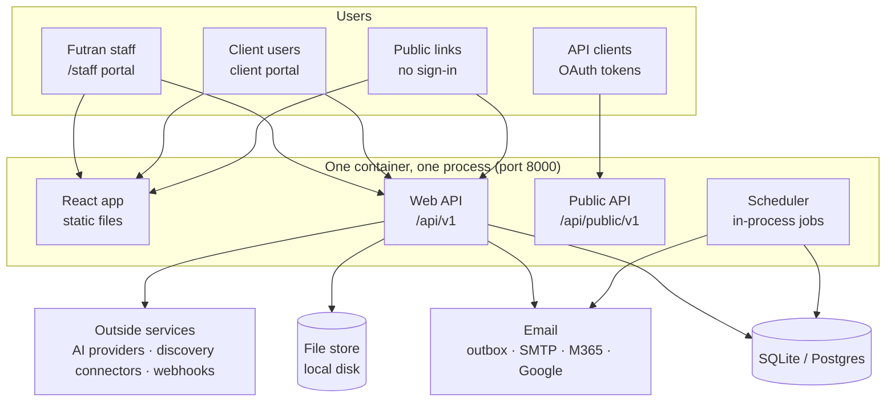

# Futran Audit Platform: deployment architecture

The platform ships as **one Docker image running one process**. FastAPI serves the API and the pre-built React app from the same port. The same code runs in every environment; only the database, file storage, secrets and outside services change.

The detailed diagram (every module group, the security layer, the scheduler, data, outside services and hosting options) is on the whiteboard: [Futran Audit Platform architecture](https://claude.ai/artifact/AstayJDr7GEai9pD9Uo6Nq).

## Where it runs

Today the platform runs only on the laptop. Four hosting options are open. All of them run the same Docker image.

### Laptop (today)

| | |
|---|---|
| Runs as | `run.bat` → uvicorn on `127.0.0.1:8000`; Python venv in `%LOCALAPPDATA%\FutranAuditPlatform\venv` |
| Database | SQLite, `%LOCALAPPDATA%\FutranAuditPlatform\data\app.db` |
| Files | Local folder `data\files` |
| Secrets | `.env` |
| Email | Outbox (test mode) |
| Sign-in codes (MFA) | Off in test mode |

### Hosting options

| | Render | Azure | AWS | GCP |
|---|---|---|---|---|
| Container service | Docker web service | App Service (container) | ECS on Fargate: a standard service with desired count 1 (see the AWS note) | Cloud Run |
| Database | Render PostgreSQL | Azure Database for PostgreSQL | RDS for PostgreSQL | Cloud SQL for PostgreSQL |
| Files, working today (`local:` store) | Persistent disk at `/app/backend/data` | Azure Files mount | EFS volume mounted into the task | Filestore (NFS) volume mount |
| Files, once an object-store adapter is built | — | Blob Storage | S3 | Cloud Storage |
| Secrets | Environment variables | Key Vault | Secrets Manager | Secret Manager |
| HTTPS | Included | Included | Load balancer with an ACM certificate | Included |
| Email | SMTP or Microsoft 365 | Microsoft 365 | Microsoft 365 or SES | Microsoft 365 or SMTP |
| Logs | Render logs | Application Insights / Log Analytics | CloudWatch | Cloud Logging |
| Keeping it to one instance | Instance count 1 | Instance count 1 | Desired count 1 | Min and max instances 1, CPU always allocated |
| Best for | Pilot with test data (decision D9) | Live clients: fits Futran's Microsoft 365 and Microsoft partner work | A client or partner that requires AWS | A client or partner that requires GCP |

**Notes on the two new options**

- **AWS.** Use ECS on Fargate, not App Runner: AWS closed App Runner to new customers on 30 April 2026 and points to ECS Express Mode instead. App Runner also had no persistent storage. On Fargate, mount EFS at `/app/backend/data` so the current file store works unchanged.
  - **Run exactly one task, including during deployments (corrected 25 Nov 2026).** A default ECS rolling deployment starts the new task before stopping the old one (maximum 200%). ECS Express Mode uses canary deployments and can auto-scale to 20 tasks. Either way, two schedulers would work the same outbox. Use a standard ECS service with desired count 1, `maximumPercent` 100, `minimumHealthyPercent` 0 and no auto scaling. Expect a short outage on each deployment. See [[Futran_Audit_Platform_Mail_Architecture]] §7.
- **GCP.** Cloud Run fits, with three settings: exactly one instance (min 1, max 1), CPU always allocated so the in-process scheduler keeps running between requests, and a Filestore NFS volume for files. A Cloud Storage FUSE mount also works, but it is not a full file system, so Filestore is the safer choice until a Cloud Storage adapter exists. The plainest alternative is one Compute Engine VM running the container with a persistent disk.
- **Lift between them.** Moving between any two options is the same job: create Postgres, restore the data, copy the files folder, set the environment variables, deploy the image. No code changes, as long as the file store stays on a mounted volume.

## What happens when the container starts

1. `alembic upgrade head`: applies database migrations (additive only).
2. `python -m app.cli seed-reference`: loads any missing reference data (law library, question bank, templates).
3. `uvicorn` serves on `$PORT` as a non-root user (uid 10001).
4. The health check calls `/api/v1/health` every 30 seconds.
5. Behind any of the hosts, `TRUST_PROXY_HEADERS=true` so rate limits see the real client address.

The first administrator is created from the host's shell with `python -m app.cli admin-link`.

## Key settings

| Setting | Laptop | Hosted |
|---|---|---|
| `DATABASE_URL` | `sqlite:///./data/app.db` | `postgresql+psycopg://…` |
| `FILE_STORE` | `local:./data/files` | `local:/app/backend/data/files` on a mounted volume (object store later) |
| `SECRET_KEY`, `BASE_URL` | local values | strong key, `https://` address |
| `MFA_REQUIRED` | `false` in test mode | `true` |
| `EMAIL_MODE` | `outbox` | `smtp`, required for any live mail, even when all mail goes through a connected Microsoft 365 or Google mailbox (see [[Futran_Audit_Platform_Mail_Architecture]] §5) |
| `ANTHROPIC_API_KEY` or an AI provider connection | optional | set for AI features |
| `VIRUS_SCAN` | `off` | `clamav` (not built yet) |
| `DISABLE_SCHEDULER` | `false` | `false` on exactly one instance |

## Gaps before live client use

| Gap | Why it matters | What to do |
|---|---|---|
| Single instance only | The scheduler runs inside the app. Group-send rows and daily runs are claimed before sending, but delivery is still at-least-once, rate limits are held in memory, and files sit on local disk. A second instance would send duplicate reminders and see different files. | Run one instance on every host. To scale out later: move jobs to a single scheduled job, rate limits to the database, and files to an object store. |
| No object-store adapter | `FILE_STORE` accepts only `local:` today, so every host needs a mounted volume. | Add one adapter behind the existing storage interface for the chosen cloud: Blob, S3 or Cloud Storage. |
| Virus scanning not connected | `VIRUS_SCAN=clamav` raises an error; uploads are stored unscanned. | Connect ClamAV (sidecar or service) before clients upload evidence. |
| Secrets store not wired | Secrets live in environment variables. | Inject them from the cloud's store: Key Vault references (Azure), Secrets Manager in the task definition (AWS), Secret Manager references (GCP). |
| Backups | The laptop relies on manual copies in `backups\`. | Use managed Postgres backups plus storage snapshots; test a restore. |
| Data repair (BUG-04) | Garbled text stored on the laptop, mostly in demo clients. | Start the hosted install with a fresh database: Linux reads the seed files as UTF-8, so it starts clean. If laptop data must move, run `backend/scripts/repair_mojibake.py` on it first. Then clear test-mode mail state; see the mail runbook, step 3. |
