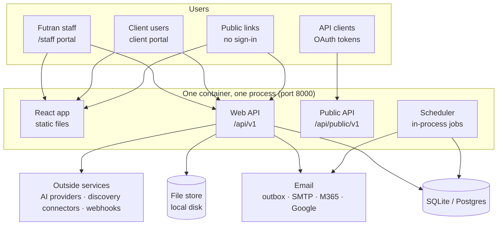

# Futran Audit Platform: deployment architecture

The platform ships as **one Docker image running one process**. FastAPI serves the API and the pre-built React app from the same port. The same code runs in every environment; only the database, file storage, secrets and outside services change.

## The three environments

| | Laptop (today) | Render pilot (planned) | Azure (target) |
|---|---|---|---|
| Purpose | Your demo and working data | Test data only (decision D9) | Live clients |
| Runs as | `run.bat` → uvicorn on `127.0.0.1:8000`; Python venv in `%LOCALAPPDATA%\FutranAuditPlatform\venv` | Docker web service | Azure App Service (container) |
| Database | SQLite, `%LOCALAPPDATA%\FutranAuditPlatform\data\app.db` | Render PostgreSQL | Azure Database for PostgreSQL |
| Files | Local folder `data\files` | Persistent disk at `/app/backend/data` | Persistent storage now; Azure Blob once built |
| Secrets | `.env` | Render environment variables | Key Vault (not wired yet) |
| Email | Outbox (test mode) | SMTP or Microsoft 365 | Microsoft 365 |
| TLS | None (localhost) | Render terminates HTTPS | App Service terminates HTTPS |
| Sign-in codes (MFA) | Off in test mode | On | On |

## What happens when the container starts

1. `alembic upgrade head`: applies database migrations (additive only).
2. `python -m app.cli seed-reference`: loads any missing reference data (law library, question bank, templates).
3. `uvicorn` serves on `$PORT` as a non-root user (uid 10001).
4. The health check calls `/api/v1/health` every 30 seconds.
5. Behind Render or Azure, `TRUST_PROXY_HEADERS=true` so rate limits see the real client address.

The first administrator is created from the host's shell with `python -m app.cli admin-link`.

## Key settings

| Setting | Laptop | Hosted |
|---|---|---|
| `DATABASE_URL` | `sqlite:///./data/app.db` | `postgresql+psycopg://…` |
| `FILE_STORE` | `local:./data/files` | `local:/app/backend/data/files` (Blob later) |
| `SECRET_KEY`, `BASE_URL` | local values | strong key, `https://` address |
| `MFA_REQUIRED` | `false` in test mode | `true` |
| `EMAIL_MODE` | `outbox` | `smtp` or a connected mailbox |
| `ANTHROPIC_API_KEY` or an AI provider connection | optional | set for AI features |
| `VIRUS_SCAN` | `off` | `clamav` (not built yet) |
| `DISABLE_SCHEDULER` | `false` | `false` on exactly one instance |

## Gaps before live client use

| Gap | Why it matters | What to do |
|---|---|---|
| Single instance only | The scheduler runs inside the app with no lock, rate limits are held in memory, and files sit on local disk. A second instance would send duplicate reminders and see different files. | Run one instance for the pilot. For Azure, move jobs to a single scheduled job, rate limits to the database, and files to Blob. |
| Azure Blob storage not built | `FILE_STORE` accepts only `local:` today. | Add a Blob adapter behind the existing storage interface. |
| Virus scanning not connected | `VIRUS_SCAN=clamav` raises an error; uploads are stored unscanned. | Connect ClamAV (sidecar or service) before clients upload evidence. |
| Key Vault not wired | Secrets live in environment variables. | Read secrets from Key Vault through App Service references. |
| Backups | The laptop relies on manual copies in `backups\`. | Use managed Postgres backups plus storage snapshots; test a restore. |
| Data repair (BUG-04) | Garbled text stored on the laptop. | Repair before any data moves to a hosted environment. |
