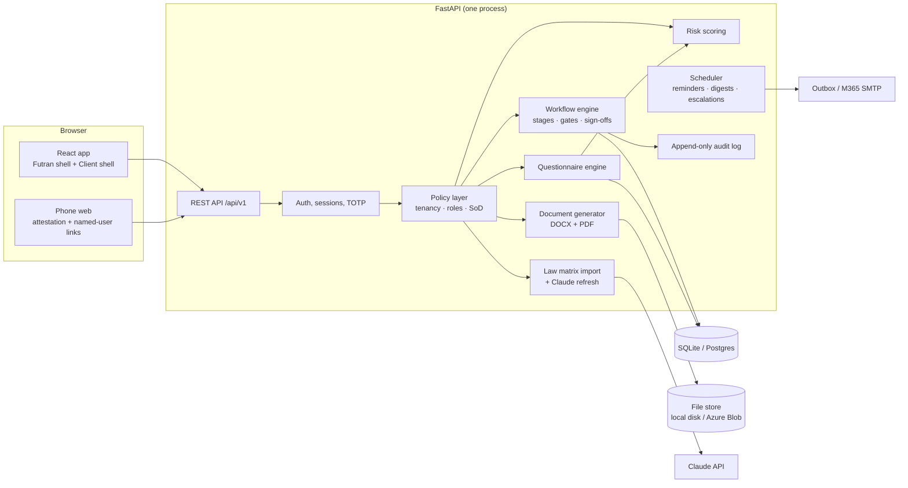

# Futran Audit Platform — Build Schematic

This is the plan of record for building v1. It reconciles four sources and records every decision made with Sour on 12 October 2026. Anything not decided here follows the developer spec.

## 1. Sources and precedence

| # | Source | Role |
|---|---|---|
| 1 | This schematic | Decisions and deviations below override the spec |
| 2 | *Futran Audit Platform — Developer Handoff Specification* **v0.2** | Functional source of truth (§1–21) |
| 3 | Screen mockups (25 screens, artifact version of 12 Oct 2026) | Layout, copy and fields per screen |
| 4 | `Futran_Global_AI_Law_Matrix.xlsx` (status 5 Oct 2026) | Law reference data. **Replaces** the US-only workbook named in spec §10.1 |
| 5 | *Futran AI Governance Audit Template v1.0* (`reference\Futran_AI_Governance_Audit_Template.docx`) | Question bank and checklist text, seeded verbatim |
| 6 | Addendum 5.1a | Its six questions are taken from spec §18.4. **The addendum file itself is not in the reference folder** (see §15) |

The design-notes artifact (`claude.ai/code/artifact/d02f9d94…`) is not shared with this account, so it has not been read. Nothing in this schematic depends on it.

## 2. Decisions log

| # | Topic | Decision |
|---|---|---|
| D1 | Relationship to the earlier AI Governance Audit App | New, separate app. The earlier app is not touched |
| D2 | v1 scope | All 9 stages; spec v0.2 screens 1–24 plus the admin screens in §7 |
| D3 | Stack | React (TypeScript, Vite) front end; Python FastAPI API; SQLite on the laptop, Postgres on Render and Azure |
| D4 | Locations | Any country. Admin edits jurisdictions and laws in the app. The data region is recorded as a label only (real residency is post-build) |
| D5 | Law maintenance | Admin-triggered refresh through the Claude API with web search. Proposals are shown as a diff with sources; Admin approves before a new matrix version is published |
| D6 | Sign-in | Full spec: password, TOTP, 7-day invitations, session timeouts. `MFA_REQUIRED=false` is allowed only in test mode, and a red test-mode bar is shown while it is off |
| D7 | Signatures | Built-in click-to-sign: typed name, timestamp, IP and document hash written to the audit log; the signed version is locked |
| D8 | Email | In-app outbox for testing; Microsoft 365 SMTP switched on by config |
| D9 | Hosting | Laptop (`setup.bat` / `run.bat`) → Render pilot (test data only) → Futran Azure. One Docker image |
| D10 | Exports | DOCX and PDF for every generated document |
| D11 | Futran's internal audit | Runs as a client tenant ("Futran Solutions — internal") |
| D12 | Fees | Kept outside the platform. No fee fields |
| D13 | Employee access by tier | Stage 3 attestation link goes to all in-scope staff (no account). After tiering, people named on Tier 2–3 use cases get a personal, no-login confirmation link (training, policy acknowledgment, oversight role). Tier 1 gets nothing further |
| D14 | Spec §21 open questions | Settled by D6, D7, D5, D11, D12 and D13 |
| D15 | Recommendations from the per-system questionnaire addendum | Accepted, but **deferred to post-build** where spec v0.2 does not already cover them (see §14) |
| D16 | Where the app lives | `IT work\strategy development\Futran Audit Platform\` (app, docs, zip) |
| D17 | Scoring light (Tier 2) systems | Domain weights are rescaled over the domains actually assessed. Residual and rating are computed as normal and labelled "light assessment". Light systems count toward the engagement's overall rating and maturity |
| D18 | Client visibility of scores | Before the draft report, the client sees only its own pre-fill answers and the document register: no scores, auditor-only answers, verified marks or draft findings. Scores first appear in the draft report (v1.0) |

## 3. Deviations from spec v0.2

| Spec says | Build does | Why |
|---|---|---|
| §10.1 imports the US-only workbook; international laws "later" | Imports the global workbook: Federal Laws, State Matrix, Global Matrix and 9 country sheets | D4 |
| §9.2 `Jurisdiction` is flat; `ClientLocation.matrix_state` | `Jurisdiction` is a tree (supranational → country → state/province → city). A location resolves to every jurisdiction above it | D4. A Berlin site picks up Germany and the EU; a Manhattan site picks up NYC, New York and US federal |
| §10.3 geography filter lists "the 26 states" | The filter lists the client's jurisdictions with their parents, then every jurisdiction that has laws | D4 |
| §3 "or SAML/OIDC SSO" | Not in v1 | Needs a client identity provider to test (post-build) |
| §21 Q1 optional employee login | D13 link model; no employee accounts | D13 |
| §15 virus scan on upload | Scanner adapter; ClamAV used when present, otherwise a logged "not scanned" | Laptop has no ClamAV |
| §9.1 `Organization` | Adds `data_region` (label) and `is_internal` (Futran's own tenant) | D4, D11 |

## 4. Architecture



| Layer | Choice | Notes |
|---|---|---|
| API | FastAPI, Pydantic v2, SQLAlchemy 2, Alembic migrations | The same code runs on SQLite and Postgres |
| Auth | argon2 password hashes, `pyotp` TOTP, server-side sessions in an httpOnly cookie, CSRF token | Idle 30 min, absolute 12 h (configurable) |
| Policy | A single `authorize(actor, action, resource)` used by every endpoint; the tenant comes from the session only | The permission matrix (§5) and separation-of-duties rules (§6) are data plus code, tested as a table |
| Front end | React 18, TypeScript, Vite, React Router, TanStack Query, React Hook Form + Zod | Own component set built to the mockups (IBM Plex Sans, navy `#1B3A6B`, blue `#2E75B6`, accent `#0098D4`). WCAG 2.1 AA; usable at 375 px |
| Packaging | The front end is pre-built and served by FastAPI as static files | `run.bat` needs only Python, not Node |
| Documents | `docxtpl` / `python-docx` for DOCX; `xhtml2pdf` from the same HTML templates for PDF | Pure Python, so it works on Windows without Word or LibreOffice. *Builder's call* |
| Files | Storage adapter: local folder (laptop), Azure Blob (later). Per-tenant prefixes, SHA-256, short-lived signed URLs, 50 MB cap | |
| Jobs | APScheduler inside the app | Invitation expiry, evidence due, document chase escalation, weekly overdue digest |
| Claude API | `anthropic` SDK, model and key in config, web search tool on | Off when no key is set; the button explains why |
| Tests | pytest (unit + API), Playwright (end to end, screenshots) | |

**Repository layout**
```
futran_audit_platform/
  backend/app/{core,auth,policy,tenancy,reference,laws,engagements,initiation,
               governance,inventory,attestation,systems,questionnaire,documents,
               findings,scoring,signoffs,reports,remediation,notifications,audit_log}
  backend/seeds/{law_matrix.xlsx, question_bank.yaml, checklists.yaml,
                 document_catalog.yaml, governance_catalog.yaml, frameworks.yaml,
                 risk_methodology_v1.yaml, templates/}
  backend/tests/
  frontend/src/{shells,screens,components,api,lib}
  e2e/
  setup.bat  run.bat  Dockerfile  README.md  .env.example
```

## 5. Data model

Every table carries `id`, `organization_id`, `created_*`, `updated_*` and `deleted_at` (soft delete). Entities are as in spec §9 and §18–19, with these changes and additions:

| Domain | Entities | Change from spec |
|---|---|---|
| Access | Organization, Department, User, RoleAssignment, ClientContact, Invitation, Session, MfaSecret, AuditLog | Organization gains `data_region`, `is_internal`. Engagement-team roles add Engagement Manager and Legal/Compliance Reviewer (§18.3) |
| Jurisdictions and laws | **Jurisdiction** (`code`, `name`, `level` supranational/country/state/city, `parent_id`, `iso_code`, `membership_of[]` for EU members), **MatrixVersion**, Regulation, **RegulationProposal** (Claude refresh: `jurisdiction_id`, `change_type` add/update/retire, `proposed_fields`, `sources[]`, `status`, `reviewed_by`), FeatureMap (country-sheet category → feature enum, editable) | Tree, versions and proposals are new |
| Scope | ClientLocation (`country`, `subdivision`, `city`, `jurisdiction_ids[]` resolved), ClientRequirement, Engagement, ScopeItem, EngagementTeam | Locations resolve through the tree |
| Initiation | DocumentTemplate, InitiationPackage, PackageDocument | As spec |
| Governance | GovernanceRequest, GovernanceDocumentItem, GovernanceRoleItem, Commitment | As spec |
| Inventory | AITool, UseCase, UsageRecord, NamedUser (+ `email`), **NamedUserLink** (token, sent, completed), InventorySnapshot (+ dated addenda), AttestationCampaign, Attestation | NamedUserLink is new (D13); see §8a |
| Systems | AISystem, Vendor (from §9.1 vendor inventory), TemplateVersion, Question, ChecklistItem, Response, ChecklistResult | As spec §18–19 |
| Documents | DocumentCatalog, DocumentRequest, DocumentChase, Evidence, EvidenceRequest | As spec §18.5 |
| Findings and scoring | Finding, RiskMethodology, SystemRiskScore, EngagementScorecard, RoadmapItem | As spec |
| Sign-off and close | SignOff, Declaration, ManagementResponse, RemediationItem, Report (versions v0.1 → v1.1), PublicSummary | As spec |
| Platform | OutboxMessage, Notification, FileObject, JobRun, Setting | New, internal |

The full schema is written in the plan as SQLAlchemy models with migrations, one domain per task.

## 6. Global law matrix import

| Sheet | Rows | Becomes |
|---|---|---|
| Federal Laws (header row 4) | 26 | Regulations under `US` (country). Category → feature via FeatureMap |
| State Matrix (header row 4) | 26 states × 9 features | State jurisdictions under `US`. Each cell is split on line breaks into candidate regulations; `—` means none |
| Global Matrix (header row 4) | 12 jurisdictions × 9 features | EU (supranational), UK, Canada, Mexico, Brazil, India, UAE, Saudi Arabia, Qatar, Bahrain, Australia, Singapore. Cells are summaries, kept as feature notes on the jurisdiction |
| EU, UK, Canada, Mexico, Brazil, India, Australia, Singapore (header row 4) | 6–9 each | Regulations under that jurisdiction, same 8 columns as Federal Laws |
| Gulf (header row 4) | 12 | The category prefix sets the jurisdiction (`UAE · Privacy` → UAE, category Privacy). **Oman** appears only here and is created as a country |
| Read Me | — | The status date ("5 October 2026") becomes the MatrixVersion date |
| Sources | 34 | Citations on the MatrixVersion |
| Coverage Summary | — | Not imported (it is computed in the app instead) |

Import rules from spec §10.1 still apply: preview before publish, *Verify* badges, `applies_to = developer` greyed out for deployers, never delete laws a client references, `superseded_by` on change, and NYC as a city under New York. Importer tests pin these row counts so a changed workbook shows up as a failed test, not as silent drift.

**Location configuration**
- A client site picks a country, then state or province, then city. Countries and subdivisions are seeded from ISO 3166 (`pycountry`).
- A site resolves to its city, state and country, plus any supranational parent (EU membership is seeded and editable). Laws from every resolved level are suggested in wizard step 2.
- Admin → Reference data → Jurisdictions: add or edit any jurisdiction, move it in the tree, add or edit laws by hand, and mark items to verify. Every edit creates a new matrix version.
- Admin → Law updates: pick jurisdictions, then run a Claude refresh. Proposals list each add, update or retire with its sources. Admin accepts or rejects each one, then publishes.

## 7. Screens

| # | Screen | Shell | Phase |
|---|---|---|---|
| 1 | Login (password, TOTP, invitation accept, MFA enrolment) | — | 1 |
| 2 | Futran dashboard | F | 3 |
| 3–7 | New client wizard (company · locations & laws · scope & team · contacts · package review) | F | 3 |
| 8 | Client page (9-stage tracker) | F | 3 |
| 9 | Invitation email (outbox rendering) | Email | 3 |
| 10 | Client initiation checklist | C | 3 |
| 10a | AI governance structure | C | 4 |
| 11 | Departments and users | C | 4 |
| 12 | Attestation tracker | C | 4 |
| 13 | Employee attestation (phone) | Phone | 4 |
| 13a | Named-user confirmation (phone, D13) | Phone | 4 |
| 14 | Add or edit use case | C | 4 |
| 15 | Inventory review and sign-offs 2–4 | C | 6 |
| 16 | Fieldwork: use case | F | 6 |
| 17 | Findings approval | F | 6 |
| 18 | Management response | C | 6 |
| 19 | Final report and public summary | F | 6 |
| 20 | Remediation | F + C | 6 |
| 21 | AI systems register | F | 5 |
| 22 | System assessment (client pre-fill in C shell) | F / C | 5 |
| 23 | System risk score | F | 5 |
| 24 | Document request register (client view in C shell) | F / C | 5 |
| A1 | Admin: Futran users and settings | F | 1 |
| A2 | Admin: jurisdictions and laws, matrix import and versions | F | 2 |
| A3 | Admin: law updates (Claude refresh review) | F | 2 |
| A4 | Admin: templates, question bank, checklists, risk methodology | F | 2 |
| A5 | Outbox and audit log viewer (CSV export) | F | 1 |

## 8. Engines

**Workflow.** Each stage gate is a named function that returns `ready` or a list of unmet conditions. The client page shows those conditions as the "what's left" list. Gates follow spec §7, with the v0.2 objects slotted in as set out in §8a. Sign-offs follow §8, with fallbacks (DPO → CAICO, Executive Sponsor → CAICO).

**Separation of duties.** The ten rules in §6 are enforced in the policy layer, and each rule has at least one passing test and one test that is refused.

**Questionnaire.** Questions, checklists and rules are data (YAML seed → database), versioned by TemplateVersion. The engine evaluates `applicability_rule` (show or hide, e.g. HIPAA, 5.1a and Vendor assurance) and `finding_rule` (auto-draft a finding). It also enforces the six golden rules in §18.1:
1. A checklist item can be ticked only with evidence linked.
2. "We will" answers count as No.
3. Interview answers need a named source person.
4. N/A needs a reason.
5. Draft findings are hidden from the client.
6. A No on a required question auto-creates a draft finding.

**Risk scoring.** Pure functions implementing spec §19.2–19.4 exactly, recalculated on every answer change until the system is locked, and stored with the methodology version. The spec's worked example is a fixed test: ATS résumé screening gives inherent 76, M 2.25, residual 58.2, final **High** from two knock-outs.

**Documents.** One template set renders to DOCX and PDF:
- 7 initiation documents
- Document request email
- Draft and final report (cover, executive summary, findings by severity, per-system profiles and scores, maturity scorecard, roadmap, declarations, appendices B and C)
- Public summary
- Audit log export

Report versioning follows the template: v0.1 → v0.2 → v1.0 → v1.1.

## 8a. Rules settled during the design review (builder's calls; flag any that are wrong)

**AI systems across the stages**

| Stage | What happens |
|---|---|
| 1 Onboarding | Systems the client already knows of are listed at initiation (§18.3 "AI systems included"). Each becomes an AISystem with status `not_started` |
| 3 Discovery | The client pre-fill opens on screen 22 for client-respondent questions only. The document request register (screen 24) is issued, due 5 business days before the fieldwork start date |
| 4 Client review | The snapshot locks the client's pre-fill answers. Later client changes create a new snapshot version with a reason |
| 5 Fieldwork | The auditor adds systems for any Tier 3 use case not yet mapped (Engagement Manager approval, as in template §1.3) and Tier 2 light systems as selected. The auditor verifies answers and completes the auditor-only questions. **Stage 5 gate:** every Tier 3 use case maps to a system whose assessment is complete and whose score is computed, there are no unanswered required questions, and all findings are submitted |
| 6 Futran QA | Sign-off 5 locks final tiers, findings and every system score |

**Report versions and declarations**

| Version | When | Signatures required first |
|---|---|---|
| v0.1 Draft | Auditor builds it in Stage 6 | — |
| v0.2 Lead review | Lead Auditor review in Stage 6 | — |
| v1.0 Client draft | Released to the client at the end of Stage 6, for management response | Sign-off 5; Lead Auditor declaration; Engagement Manager sign-off; Quality Reviewer sign-off **only if a QA Reviewer is assigned** (otherwise recorded as "no QA Reviewer assigned") |
| v1.1 Final | Issued in Stage 8 | Sign-off 7; then the client signs the acknowledgement and remediation commitment (§18.8) |

**Named-user confirmation links (D13)**
- `NamedUser` gains `email`, which is required for Tier 2–3 named users who don't have an account.
- Links go out when the client submits a use case with a proposed tier of 2 or 3. They go out again if the auditor raises the tier in Stage 5.
- Sign-off 2 for a department requires every link in that department to be completed, or marked "unable to confirm" with a reason.
- A confirmation that arrives after the snapshot lock is appended as a dated addendum to the snapshot, not an edit.

**Who pre-fills a system.** The client's technical or system owner is a **Contributor** with an assignment scoped to that AI system (`scope_type = system`). They can answer client-respondent questions and upload evidence for that system only.

**Engagement types.** All three types run the same 9-stage workflow. Sign-off 8 and the public summary are required only when a public-summary law (e.g. NYC LL144) is in scope; the client uploads impact ratios as evidence, with no calculation. Carrying an inventory forward into an annual review is post-build.

**Where v1 is verified.** The build and the full Playwright journey run in Claude's cloud workspace (Linux). The laptop run is Sour's acceptance step:
- `setup.bat` (needs Python 3.11 or later on PATH; installs from PyPI, the same as the earlier app)
- then `run.bat`
- then the demo sign-ins in the README

## 9. Security and privacy

- Spec §15 is implemented in full.
- The tenant ID always comes from the session.
- Attestation counts below 3 show as "fewer than 3".
- The employee data notice must be acknowledged before a campaign can launch.
- The audit log is append-only, with no update or delete path in code or API.
- Retention defaults to 7 years after completion, configurable per engagement.
- Secrets live only in `.env`.
- The test-mode bar shows whenever `MFA_REQUIRED=false` or email is in outbox mode.

## 10. Demo data

| Tenant | Purpose |
|---|---|
| Futran Solutions (auditor) | Chief Auditor, Admin, two Auditors, QA Reviewer, Engagement Manager |
| ABC Corp (New York HQ, Chicago, remote US) | Matches the mockups. Four AI systems (ATS résumé screening SYS-001 vendor/full, invoice anomaly SYS-002 in-house/full, interview chatbot SYS-003 vendor/light, GenAI proposal drafting SYS-004 personal accounts/light). The engagement runs through all 9 stages |
| Meridian GmbH (Berlin, Bangalore) | Shows global locations: EU AI Act, GDPR and India DPDP are suggested; it stops at Stage 3 |
| Futran Solutions — internal | Futran's own AI usage audit (D11), at Stage 2 |

Each role has a demo sign-in. `run.bat --reset-demo` rebuilds the demo data.

## 11. Testing and definition of done

- **Unit:**
  - law importer row counts
  - jurisdiction resolution
  - tiering rules
  - every stage gate
  - every SoD rule, allowed and refused
  - questionnaire applicability and finding rules
  - scoring, including the worked example and every knock-out
  - DOCX/PDF generation smoke tests
- **API:** permission-matrix table tests, run for each role against each action.
- **End to end (Playwright):**
  - a new client goes from draft to completed through every stage, signing in as each role in turn
  - the employee attestation and named-user links at 375 px
  - screenshots of all 30 screens are attached to the hand-over
- **v1 is done when:**
  - all tests pass
  - the ABC Corp journey completes end to end on the laptop
  - Word and PDF report exports open cleanly
  - the app is in the `Futran Audit Platform` folder with a zip
  - the README covers setup, sign-ins, configuration and the move to Render

## 12. Build phases and estimate

| Phase | Work packages | Done when | Hours |
|---|---|---|---|
| 0 | Detailed task plan (test-first, one task per domain) | Plan approved | 2 |
| 1 Foundation | Repo and CI scripts; database and migrations; auth, TOTP, invitations, sessions; tenancy; policy layer with SoD; audit log; React app with both shells and the component set; admin users; outbox | Every role can sign in with MFA; the permission table tests pass | 6–7 |
| 2 Reference data | Global matrix importer with preview and publish; jurisdiction tree and editor; ISO seed; Claude refresh and review; frameworks; governance catalog; document catalog; templates; question bank and checklists from Template v1.0 + 5.1a; risk methodology v1 | Importer counts pinned; question-bank counts pinned; a refresh proposal can be accepted end to end (with a stubbed Claude response in tests) | 8–10 |
| 3 Onboarding | Dashboard; wizard steps 1–5 with §18.3 fields and law picker; package generation (7 documents, DOCX/PDF); approve and send; invitation; client page; initiation checklist; sign-off 1 | Draft → approved → sent → CAICO signs; Stage 1 gate passes | 7–8 |
| 4 Setup and discovery | Departments and users CSV; governance request with commitments and coverage panel; attestation campaign and phone form; use cases with live tiering; named users and confirmation links | Stage 2 and 3 gates pass for ABC Corp | 7–8 |
| 5 Systems and evidence | Systems register; questionnaire screen with all golden rules and the vendor variant; document request register with chase and escalation; auto-draft findings; risk score screen and lock | ABC Corp SYS-001 scores to the worked example | 9–11 |
| 6 Review to close | Sign-offs 2–8 with snapshot lock; fieldwork use-case screen; findings QA; draft and final report with scorecard, roadmap and declarations; management response; public summary; remediation and commitments; notifications and digests | ABC Corp reaches `completed` | 9–11 |
| 7 Hand-over | Demo tenants; Playwright journey and screenshots; `setup.bat`, `run.bat`, Dockerfile, README; copy to folder and zip; project doc updated | Definition of done met | 4–5 |
| | | **Total** | **52–62** |

**Estimate change.** The earlier 36–45 hours was based on spec v0.1 plus the addendum. Spec v0.2 adds the questionnaire engine and question bank (about 250 questions and 58 checklist items), per-system risk scoring, the document request register, declarations, the maturity scorecard and the roadmap.

**Calendar.** Roughly **9–11 working days**, with a check-in and screenshots at the end of phases 1, 3, 5 and 7.

## 13. Configuration (`.env`)

| Setting | Laptop default | Pilot/production |
|---|---|---|
| `DATABASE_URL` | `sqlite:///data/app.db` | Postgres URL |
| `FILE_STORE` | `local:./data/files` | `azureblob:…` |
| `MFA_REQUIRED` | `true` (can be set to `false` in test mode) | `true` |
| `EMAIL_MODE` | `outbox` | `smtp` (+ M365 settings) |
| `ANTHROPIC_API_KEY`, `CLAUDE_MODEL` | empty (refresh disabled) | set |
| `DATA_REGION_LABEL` | `us-east` | per install |
| `SESSION_IDLE_MIN`, `SESSION_MAX_HOURS` | 30, 12 | 30, 12 |
| `RETENTION_YEARS_DEFAULT` | 7 | 7 |
| `VIRUS_SCAN` | `off` | `clamav` |

## 14. Post-build backlog (flagged, not in v1)

From the per-system questionnaire addendum (D15). Spec v0.2 already covers the per-system questions; these extras wait:
- [ ] Vendor no-login link to answer due diligence and upload documents directly, with the client reviewing before submission
- [ ] Extended vendor due diligence beyond §9.2 and V.01–V.08 (data retention, deletion at exit, change notification, indemnity, regulator cooperation, client risk rating with next review date)
- [ ] 14-item vendor document checklist as a vendor-level view (v1 uses Appendix A category 6 in the document register)
- [ ] Vendor record reused across engagements, with a Futran vendor risk rating and a next-review reminder
- [ ] CSV bulk load of AI systems and vendors
- [ ] Employee-declared tools from the attestation proposed as unconfirmed AI systems
- [ ] Management representation text extended to name in-house and vendor systems (v1 keeps the spec text, which Admin can edit)
- [ ] Depth by tier for systems outside spec §19.1's selection rule

Other flagged items:
- [ ] Per-tenant data residency (D4: v1 records the region as a label only)
- [ ] SAML / OIDC single sign-on per client
- [ ] Microsoft 365 SMTP sending mailbox and credentials
- [ ] Render deploy with Postgres; then Azure (Blob storage, Postgres, Key Vault)
- [ ] ClamAV on the hosted environment
- [ ] DocuSign / Adobe Sign (only if a client requires it)
- [ ] Scheduled (monthly) law refresh in addition to Admin-triggered
- [ ] Automated bias statistics (spec §1 out of scope)
- [ ] Annual review carry-forward (copy the prior inventory, systems and open commitments into a new engagement)

## 15. Inputs still needed (none block Phase 1)

| Item | Needed by | If not available |
|---|---|---|
| Addendum 5.1a document (for its 5 checklist items for §5.4) | Phase 2 | Five items drafted from the 5.1a questions, marked *pending Futran review* in the question bank |
| Anthropic API key | Phase 2 test of live refresh | Refresh is built and tested with a stub; the live call waits for the key |
| Engagement letter, roles note, data notice and getting-started wording, if Futran has house versions | Phase 3 | Drafted to the spec in plain professional language; Admin can edit the templates |
